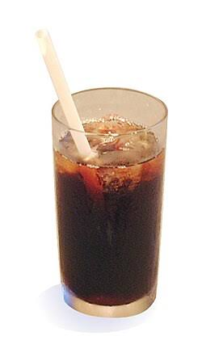

# Website One Page – Selaras Coffee

Tugas Individu Desain Web (Bootstrap 5)

| | |
|---|---|
| Nama | Karel Abimanyu Ahpandi |
| NIM | 4525210031 |
| Kelas | A |
| Program Studi | Teknik Informatika, Universitas Pancasila |
| Dosen | Ari Wibowo |
| Studi kasus | UMKM Selaras Coffee |
| Framework | Bootstrap 5.3.3 (lewat CDN) |
| Tema visual | Latar putih lembut dengan detail bergaya Omen (Valorant) |

---

## 1. Deskripsi Singkat

Halaman tunggal (one page) untuk UMKM kopi Selaras Coffee yang bisa dipresentasikan kepada calon pelanggan dan mitra bisnis. Isinya: hero, tiga menu andalan, promo, detail menu lewat modal, profil singkat usaha, dan form kontak.

Bootstrap dipakai untuk grid, navbar, card, alert, modal, dan form. Identitas visual dibuat lewat custom CSS: latar tetap putih lembut, sedangkan nuansa Omen hanya muncul di detail, yaitu ungu gelap, sudut tombol dan card yang terpotong miring, panel hero bergaya portal, dan uap kopi yang bergerak pelan.

## 2. Struktur Folder

```text
selaras-coffee/
├── index.html                   -> seluruh isi halaman
├── README.md                    -> dokumentasi proyek
├── css/
│   └── style.css                -> custom CSS (branding dan tampilan)
└── dokumentasi/
    ├── ringkasan.md             -> ringkasan tugas (150-250 kata)
    ├── Laporan_Selaras_Coffee.docx -> laporan Word berisi ringkasan dan screenshot
    ├── img/                     -> foto menu yang dipakai di card
    │   ├── es-kopi-selaras.png
    │   ├── cold-brew-malam.png
    │   └── tubruk-tenang.png
    └── screenshot/              -> bukti tampilan desktop dan mobile
        ├── 1-desktop.png
        ├── 2-mobile.png
        ├── 3-desktop-modal.png
        └── 4-mobile-menu.png
```

## 3. Cara Menjalankan

1. Ekstrak folder proyek.
2. Buka `index.html` di browser, atau jalankan server lokal dari folder proyek:

   ```bash
   python3 -m http.server 8000
   ```

3. Jika memakai server lokal, buka <http://localhost:8000>.
4. Pastikan komputer terhubung ke internet karena Bootstrap dan font dimuat dari CDN.

## 4. Komponen yang Dipakai (Sesuai Ketentuan Tugas)

| No | Komponen | Letak di `index.html` | Class Bootstrap utama |
|---|---|---|---|
| 1 | Navbar responsif | `<nav>` paling atas | `navbar navbar-expand-lg fixed-top`, `navbar-toggler`, `collapse navbar-collapse` |
| 2 | Hero section | `<header id="beranda">` | `row align-items-center`, `display-3`, `lead`, `btn btn-lg` |
| 3 | Tiga card menu | section `#menu` | `card h-100`, `card-img-top`, `card-body`, `card-title`, `card-text` |
| 4 | Alert promo | Awal `<main>`, sebelum section menu | `alert alert-dismissible fade show`, `btn-close` |
| 5 | Modal detail | Antara `</main>` dan footer, satu modal per menu (3 modal) | `modal fade`, `modal-dialog-centered`, `modal-content` |
| 6 | Form kontak | section `#kontak` | `form-control`, `form-select`, `form-label` |
| 7 | Footer | Bagian paling bawah | `row g-4`, kelas kustom `sc-footer` |
| 8 | Custom CSS | `css/style.css` | variabel warna, font, `clip-path`, animasi uap |

## 5. Penjelasan Kode per Bagian

### 5.1 Bagian `<head>`

- `<meta name="viewport" ...>` membuat halaman mengikuti lebar layar HP supaya breakpoint Bootstrap bekerja.
- Bootstrap 5.3.3 dimuat dari CDN jsDelivr langsung di `index.html`, lalu `css/style.css` dipasang setelahnya. Urutan ini penting karena aturan yang muncul belakangan menang jika spesifisitasnya sama, sehingga CSS kustom bisa menimpa gaya bawaan.
- Font Rajdhani (judul, tombol) dan Nunito Sans (teks) dimuat lewat Google Fonts; `preconnect` mempercepat koneksi ke server font.

### 5.2 Navbar responsif

- `navbar-expand-lg`: menu mendatar di layar 992px ke atas, berubah menjadi tombol hamburger di layar lebih kecil.
- `fixed-top`: navbar menempel di atas saat halaman di-scroll.
- Tombol hamburger memakai `data-bs-toggle="collapse"` dan `data-bs-target="#menuUtama"` untuk membuka atau menutup menu.
- `data-bs-spy="scroll"` pada `<body>` (scrollspy) membuat link menu otomatis menyala sesuai bagian yang sedang dilihat.

### 5.3 Hero section

- Dua kolom: teks di kiri, panel ilustrasi di kanan. Di layar kecil urutannya dibalik (`order-1 order-lg-2`) sehingga ilustrasi muncul lebih dulu.
- Ilustrasi cangkir berupa SVG inline. Tiga garis uap (`.wisp`) dianimasikan dengan CSS, tanpa JavaScript.

### 5.4 Alert promo

- `alert-dismissible` dan `btn-close` dengan `data-bs-dismiss="alert"` membuat alert bisa ditutup pengunjung.
- Warnanya diganti lewat kelas kustom `alert-sc` agar sesuai branding.

### 5.5 Card menu dan foto

```html

```

- `row g-4` dan `col-md-6 col-lg-4`: satu card per baris di HP, dua di tablet, tiga di desktop.
- `h-100` menyamakan tinggi card; `d-flex flex-column` pada `card-body` dan `mt-auto` pada harga membuat harga dan tombol selalu rata di bawah.
- `.sc-photo` mengatur tinggi foto 170px dengan `object-fit: cover`, jadi foto dengan rasio apa pun terpotong rapi tanpa gepeng.
- Path foto relatif terhadap `index.html`.

### 5.6 Modal detail menu

Ada tiga modal, masing-masing untuk satu menu: `modalEsKopi`, `modalColdBrew`, dan `modalTubruk`.

- Tombol "Lihat detail" membuka modal lewat `data-bs-toggle="modal"` dan `data-bs-target="#modalEsKopi"` (id disesuaikan per menu).
- `data-bs-dismiss="modal"` pada tombol X, tombol "Tutup", dan tombol "Pesan sekarang" menutup modal. Tombol "Pesan sekarang" sekaligus melompat ke form kontak lewat `href="#kontak"`.
- `modal-dialog-centered` menempatkan modal di tengah layar.
- `aria-labelledby` menghubungkan modal dengan judulnya agar bisa dibaca screen reader.

### 5.7 Form kontak

- Kolom: nama, email, keperluan (select), dan pesan. Semuanya `required`.
- `type="email"` membuat browser memeriksa format email. `minlength` membatasi isian terlalu pendek pada nama dan pesan.
- `<label for="nama">` terhubung dengan input ber-`id="nama"`, sehingga label bisa diklik.
- Validasi memakai bawaan HTML5, jadi pesan error muncul sebagai balon dari browser. Tidak ada JavaScript kustom.
- `action="#kontak" method="get"` hanya mengarahkan kembali ke bagian kontak. Form belum mengirim data ke server; pengiriman ke email atau database membutuhkan backend.

### 5.8 Footer

Tiga kolom: identitas brand, jam buka, dan kontak. Baris paling bawah memuat hak cipta dan identitas pembuat tugas.

### 5.9 Script

```html
<script src="https://cdn.jsdelivr.net/npm/bootstrap@5.3.3/dist/js/bootstrap.bundle.min.js"></script>
```

JavaScript Bootstrap menjalankan hamburger navbar, tombol penutup alert, modal, dan scrollspy. Proyek ini tidak menambahkan JavaScript kustom.

## 6. Penjelasan Custom CSS (`css/style.css`)

| Bagian | Fungsi |
|---|---|
| `h1, h2, h3, .btn { font-family }` | Memakai Rajdhani untuk judul dan tombol; teks biasa memakai Nunito Sans lewat variabel `--bs-body-font-family`. |
| `:root { --sc-bg, --sc-deep, --sc-violet, ... }` | Variabel warna dan ukuran potongan sudut, dipakai ulang agar mudah diganti. |
| `.sc-nav` | Navbar putih transparan dengan garis ungu tipis di bawahnya. |
| `.btn-sc`, `.btn-outline-sc` | Tombol dengan sudut terpotong memakai `clip-path: polygon(...)`. |
| `.sc-portal` | Panel hero ungu gelap bersudut miring dengan lingkaran putus-putus yang berputar pelan. |
| `.wisp` dan `@keyframes asap` | Animasi uap kopi naik dan memudar. |
| `.alert-sc` | Alert dengan garis tepi kiri ungu, tanpa sudut membulat. |
| `.sc-card` | Card dengan sudut kanan atas terpotong dan garis tepi kiri ungu. |
| `.sc-photo` | Foto menu setinggi 170px dengan `object-fit: cover`. |
| `.sc-about`, `.sc-stat` | Latar ungu muda untuk bagian Tentang dan kotak angka. |
| `.sc-badge` | Label kecil "Terlaris" dan "Baru" di judul card. |
| `.sc-form`, `.sc-modal` | Gaya form dan modal sesuai branding. |
| `.sc-footer` | Footer ungu gelap dengan garis atas lilac. |
| `section[id] { scroll-margin-top: 72px }` | Judul bagian tidak tertutup navbar saat menu diklik. |
| `@media (max-width: 575.98px)` | Penyesuaian jarak dan ukuran judul di HP. |
| `@media (prefers-reduced-motion: reduce)` | Mematikan animasi bagi pengguna yang meminta gerakan dikurangi. |

## 7. Cara Mengganti Foto Menu

1. Siapkan foto sendiri, usahakan di bawah 300 KB.
2. Beri nama sama persis dengan file di `dokumentasi/img/` (`es-kopi-selaras.png`, `cold-brew-malam.png`, `tubruk-tenang.png`) dan timpa file lama. Jika foto berformat `.jpg`, ubah juga ekstensi di `src` pada `index.html`.
3. Ambil ulang screenshot di `dokumentasi/screenshot/` supaya sesuai tampilan terbaru.

Foto yang ada sekarang hanya gambar pengganti sementara (placeholder).

## 8. Masalah yang Ditemukan dan Solusinya

| Masalah | Penyebab | Solusi |
|---|---|---|
| Tampilan terlihat seperti template Bootstrap biasa | Gaya bawaan Bootstrap seragam | Variabel warna, `clip-path`, font khusus, dan panel hero lewat `style.css` |
| Card dengan deskripsi berbeda panjang tidak sejajar | Tinggi card mengikuti isinya | `h-100` pada card, `d-flex flex-column` pada `card-body`, dan `mt-auto` pada harga dan tombol |
| Judul bagian tertutup navbar saat menu diklik | Navbar `fixed-top` menutupi bagian atas | `scroll-margin-top: 72px` pada section |
| Form bisa dikirim dalam keadaan kosong | Belum ada pemeriksaan kolom | Atribut `required`, `minlength`, dan `type="email"` untuk validasi bawaan HTML5 |

## 9. Bukti yang Dikumpulkan

- Source code: folder proyek ini.
- Screenshot desktop dan mobile: `dokumentasi/screenshot/`.
- Ringkasan tugas: `dokumentasi/ringkasan.md` dan `dokumentasi/Laporan_Selaras_Coffee.docx`.
- Pembagian peran: tugas individu, sehingga seluruh pekerjaan dikerjakan sendiri.
