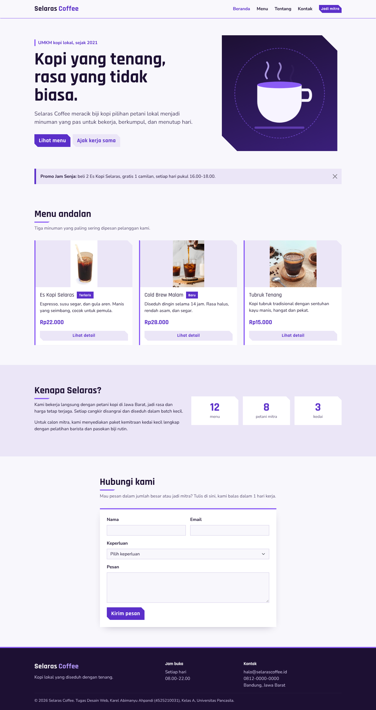
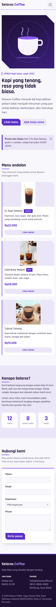

# Selaras Coffee — One Page Company Profile UMKM

Website **Company Profile** satu halaman (*One Page Website*) untuk studi kasus UMKM **Selaras Coffee**, dibuat menggunakan **Bootstrap 5.3.3** dan **Custom CSS**. Website ini dirancang untuk memperkenalkan usaha, menampilkan menu andalan, informasi promo, dan profil singkat, serta menyediakan form kontak bagi calon pelanggan dan mitra.

Tugas Individu Praktikum 10 Desain Web — Karel Abimanyu Ahpandi (4525210031), Kelas A, Universitas Pancasila.

---

## 📁 Struktur Project

```text
selaras-coffee/
│
├── index.html
├── css/
│   └── style.css
├── dokumentasi/
│   ├── img/
│   │   ├── es-kopi-selaras.png
│   │   ├── cold-brew-malam.png
│   │   └── tubruk-tenang.png
│   ├── screenshot/
│   │   ├── 1-desktop.png
│   │   ├── 2-mobile.png
│   │   ├── 3-desktop-modal.png
│   │   └── 4-mobile-menu.png
│   ├── ringkasan.md
│   └── Laporan_Selaras_Coffee.docx
└── README.md
```

---

## Ringkasan Pengembangan (Perubahan, Masalah, dan Solusi)

Website Selaras Coffee dibangun satu halaman dengan **Bootstrap 5.3.3** yang dimuat lewat CDN. Komponen yang dipakai adalah navbar responsif, *hero*, tiga *card* menu, satu *alert* promo, tiga *modal* detail menu, form kontak, dan footer. Branding dibuat melalui stylesheet custom (`css/style.css`) dengan palet ungu, font **Rajdhani** untuk judul, **Nunito Sans** untuk teks, serta sudut terpotong (`clip-path`) pada tombol, card, dan hero sebagai ciri khas visual.

Perubahan utama dari tampilan bawaan Bootstrap ada pada variabel warna dan font di `:root`, gaya tombol, card, alert, modal, dan form. Animasi uap kopi pada hero dibuat dengan CSS dan dimatikan bagi pengguna yang memilih *reduced motion*.

Masalah pertama, navbar `fixed-top` menutupi judul bagian saat menu diklik. Solusinya memberi *padding* atas pada hero dan `scroll-margin-top` pada setiap section, ditambah *scrollspy* Bootstrap agar menu aktif berganti otomatis. Masalah kedua, tinggi card tidak seragam karena panjang deskripsi berbeda. Solusinya memakai `h-100` dan *flex column*, dengan harga bermargin `mt-auto` agar tombol sejajar. Masalah ketiga, tombol "Pesan sekarang" pada modal tidak menutup modal, karena `data-bs-dismiss` pada tautan `href="#kontak"` membuat Bootstrap mencari elemen `#kontak`, bukan modalnya. Solusinya menambahkan `data-bs-target` yang menunjuk ke modal masing-masing.

Tampilan diuji pada lebar desktop 1366 px dan mobile 390 px tanpa *scroll* horizontal.

---

## Output

Tampilan desktop:



Tampilan mobile:



---

## Cara Menjalankan Project

1. Ekstrak file ZIP project.
2. Pastikan file `index.html`, folder `css/`, dan folder `dokumentasi/img/` berada dalam struktur folder yang sama seperti di atas.
3. Klik dua kali file `index.html` untuk membukanya langsung di browser (Chrome, Edge, atau Firefox).
4. Pastikan perangkat terhubung ke internet agar Bootstrap CDN dan Google Fonts dapat dimuat. Foto menu diambil dari folder lokal `dokumentasi/img/`.
5. Untuk menguji tampilan *mobile* saat mengambil screenshot, tekan `F12` (*Inspect Element*) di browser lalu aktifkan ikon *Toggle Device Toolbar* (`Ctrl + Shift + M`).

> **Catatan:** Project ini hanya mencakup front-end. Form kontak memakai validasi bawaan HTML5 dan belum terhubung dengan backend, WhatsApp, atau database, sehingga pesan belum dikirim atau disimpan.
